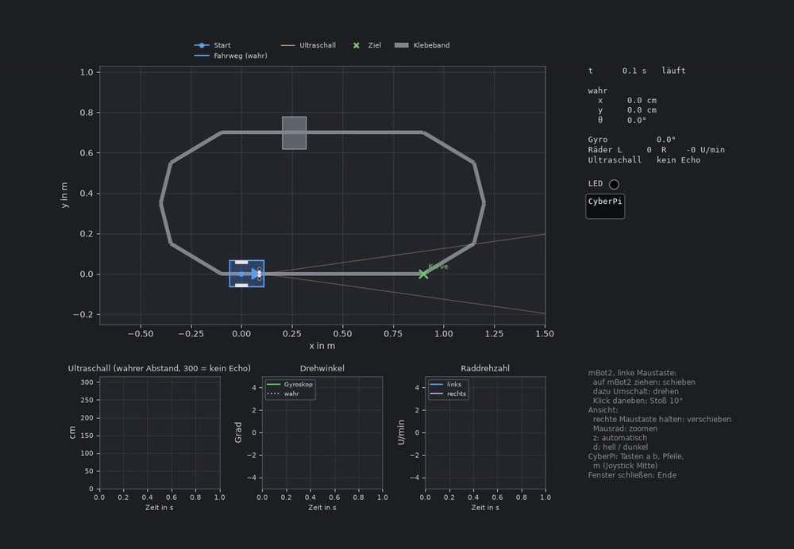

# Mobile Robotik: Codebeispiele zur Vorlesung

Beispiele zum Nachvollziehen und Ausprobieren: Laserscans auswerten, einen Flur kartieren und
Programme für den mBot2 ohne Gerät am PC testen. Das Repo wird fortlaufend aktualisiert; eigene
Änderungen am besten in einer eigenen Kopie (Fork) machen.

Erste Schritte: [Repository herunterladen und aktualisieren](#repository-code-herunterladen-und-aktualisieren)
und [Umgebung einrichten](#umgebung-einrichten) stehen am Ende dieser Seite.

## Inhalt des Repositorys

**Laserscanner**

| Datei | Inhalt |
|---|---|
| [01_lidar_polar_kartesisch.py](01_lidar_polar_kartesisch.py) | Kiste vor Wand: Polarplot, Umrechnung nach x und y |
| [02_flur_mapping.py](02_flur_mapping.py) | Mapping: Ein Bot entdeckt einen Flur (Animation) |
| [03_lidar_realistisch.py](03_lidar_realistisch.py) | Derselbe Flur wie ein echter Scan: Rauschen, Aussetzer, Mischpixel |
| [filtern.py](filtern.py) | Messwerte filtern: Plausibilität, gleitender Mittelwert und Median |
| [lidar_sim.py](lidar_sim.py) | Kleiner Laserscanner-Simulator für die Beispiele |

**mBot2**

| Datei | Inhalt |
|---|---|
| [04_mbot_strecke_fahren.py](04_mbot_strecke_fahren.py) | 1 m geradeaus nach den Radencodern |
| [05_mbot_wand.py](05_mbot_wand.py) | Vor einer Wand anhalten (Ultraschall), 90° drehen (Gyro) |
| [06_mbot_linie_folgen.py](06_mbot_linie_folgen.py) | Einer Klebebandlinie folgen (P-Regler), vor einer Kiste anhalten |
| [06_parcours.toml](06_parcours.toml) | Szene zu 06: Rundkurs mit Kiste, Vorlage für eigene Szenen |
| [mbot_sim_start.py](mbot_sim_start.py) | Starter: mBot2-Programm unverändert am PC laufen lassen |
| [mbot_sim/](mbot_sim/) | Simulierter mBot2: `cyberpi`, `mbot2`, `mbuild`, `event` ohne Gerät |

**Labore und Videos**

| Datei | Inhalt |
|---|---|
| [labor1/US_Messung_Template.py](labor1/US_Messung_Template.py) | Vorlage Ultraschall-Messreihe, Lücken zum Ergänzen |
| [labor2/programmgeruest.py](labor2/programmgeruest.py) | Programmgerüst: Positionsbestimmung, Fahrfunktionen zum Ergänzen |
| [videos/](videos/) | Videos zu 02, 03 und einer mBot2-Fahrt, ohne Python anzusehen |

Start am PC, im Ordner des Repos:

```powershell
python 01_lidar_polar_kartesisch.py
python mbot_sim_start.py 06_mbot_linie_folgen.py --welt 06_parcours.toml --plot
python mbot_sim_start.py labor2\programmgeruest.py --welt zielpunkte --pose
```

## mBot2 Simulation (ohne Gerät)

Ein Programm für den mBot2 läuft unverändert am PC, so wie es in mBlock hochgeladen wird:

```powershell
python mbot_sim_start.py 04_mbot_strecke_fahren.py     # leerer Raum
python mbot_sim_start.py mein_programm.py --wand 80    # Wand 80 cm vor dem Ultraschallsensor
python mbot_sim_start.py mein_programm.py --realistisch   # ungleiche Räder, Schlupf, Gyro-Drift wie am echten mBot2
python mbot_sim_start.py mein_programm.py --aufgebockt    # Räder drehen frei, der mBot2 bleibt stehen
python mbot_sim_start.py mein_programm.py --gui           # Fenster: Welt von oben, Hindernisse, mBot2, Fahrweg
python mbot_sim_start.py mein_programm.py --pose          # dazu gestrichelt die Pose, die das Programm berechnet
python mbot_sim_start.py mein_programm.py --plot        # dazu Verläufe: Ultraschall, Drehwinkel, Raddrehzahl
python mbot_sim_start.py mein_programm.py --welt zielpunkte --gui    # Szene: zielpunkte, hindernis, raum oder eigene .toml
python mbot_sim_start.py mein_programm.py --video fahrt.mp4 --bild fahrt.png   # Lauf aufzeichnen
```

`cyberpi`, `mbot2`, `mbuild` und `event` kommen dabei aus [mbot_sim/](mbot_sim/). Die Tasten des CyberPi
bedient man mit der PC-Tastatur: a und b sind die Tasten A und B, die Pfeiltasten der Joystick,
m (oder Enter) drückt den Joystick in der Mitte. Ohne Fenster nimmt das Terminal die Tasten an
(nur unter Windows), und die Anzeige des CyberPi erscheint in der Konsole; mit Fenster (`--gui`,
siehe unten) gelten die Tasten im Fenster, auf jedem System. Am Ende, oder nach Ctrl+C, nennt der
Starter die wahre Position des simulierten mBot2.

Der simulierte mBot2 hat einen Radradius von 3,25 cm und eine Spurweite von 11,5 cm. Mit
`--realistisch` weicht er davon ab wie ein echter mBot2; die eigenen Werte für den echten mBot2
kommen aus der Kalibrierung in Labor 1.

Mit `--gui` öffnet sich ein Fenster mit der Welt von oben: Hindernisse, mBot2 mit Ultraschall-Kegel,
der wahre Fahrweg, daneben Pose, Gyro, Raddrehzahlen, LED und Anzeige des CyberPi. Die Tasten des
CyberPi gelten dann im Fenster. `--pose` zeichnet zusätzlich
gestrichelt die Pose, die das Programm selbst berechnet, aus seinen globalen Variablen `x`, `y`,
`theta` (Meter, theta in rad; andere Namen mit `--pose px,py,kurs`). So sieht man, wie die
Koppelnavigation von der wahren Pose wegläuft. Fenster schließen beendet das Programm. Das Fenster ist
dunkel; Taste d schaltet auf hell um, `--hell` startet hell.
Mausrad: zoomen, rechte Maustaste gedrückt halten: Ansicht verschieben. Danach läuft der Ausschnitt nicht
mehr mit, bis Taste z ihn wieder automatisch einstellt.



*So sieht das Fenster aus, hier mit [06_mbot_linie_folgen.py](06_mbot_linie_folgen.py) in der Szene
[06_parcours.toml](06_parcours.toml) und `--plot`: Der mBot2 folgt dem Klebeband und hält vor der Kiste.
Unten Ultraschall, Drehwinkel und Raddrehzahlen. In voller Auflösung:
[videos/mbot_sim_linie.mp4](videos/mbot_sim_linie.mp4).*

Den mBot2 mit der linken Maustaste ziehen schiebt ihn von Hand vor oder zurück, mit gedrückter
Umschalttaste dreht man ihn; die Räder rollen dabei ab, Encoder und Gyroskop messen mit, wie beim
Testbetrieb in Labor 2. Ein Klick neben den mBot2 stößt ihn an (10°; Klick links von ihm dreht ihn nach rechts). Das
Gyroskop misst den Stoß, die Encoder nicht. Hindernisse halten den mBot2 auf: Er bleibt stehen, die
Räder drehen durch, und die Encoder zählen weiter. `--plot` zeigt unter der Welt den Verlauf von
Ultraschall-Abstand, Drehwinkel (Gyroskop und wahr) und Raddrehzahlen.

Szenen (`--welt`): `zielpunkte` mit Startmarke und drei Zielpunkten Z1 bis Z3, `hindernis` dazu mit einer
Kiste auf dem Weg, `raum` mit Wänden. Eine eigene Szene ist eine kleine TOML-Datei mit Hindernissen,
Klebeband, Zielen und Startpose; ein Beispiel ist [06_parcours.toml](06_parcours.toml), das Format steht in
[mbot_sim/szenen.py](mbot_sim/szenen.py).
`--video` speichert den Lauf als MP4 (braucht das Paket `imageio-ffmpeg`), `--bild` das letzte Bild.

Eine eigene Welt (Hindernisse, Klebeband, Ziele, Startpose) beschreibt man am einfachsten in einer
TOML-Datei und startet mit `--welt datei.toml`, wie [06_parcours.toml](06_parcours.toml) für Beispiel 06;
das Programm bleibt dabei unverändert. Wer die Welt im Programm selbst einrichten oder auslesen will
(etwa die wahre Position), bindet sie dort ein, wie in [05_mbot_wand.py](05_mbot_wand.py):

```python
from mbot_sim import installieren
cyberpi, mbot2, welt = installieren()     # danach liefern import cyberpi, mbot2, mbuild den simulierten mBot2
welt.konfigurieren(hindernisse=[WAND], kollision=True)
welt.fenster(fahrt, plot=True)            # fahrt() läuft im Hintergrund, das Fenster im Vordergrund
```

## Repository (Code) herunterladen und aktualisieren

Am einfachsten in [VS Code](https://code.visualstudio.com/): Git ist dort eingebaut, eine Erweiterung
braucht es nicht. Fehlt Git auf dem Rechner, bietet VS Code in der Ansicht *Quellcodeverwaltung*
(Strg+Umschalt+G) den Download an; danach VS Code neu starten.

- **Klonen:** Strg+Umschalt+P, *Git: Klonen* (*Git: Clone*), die Adresse
  `https://github.com/oliverprenzel/robotics-lecture.git` einfügen, einen Ordner wählen. VS Code legt
  dort den Unterordner `robotics-lecture` an und bietet an, ihn zu öffnen.
- **Aktualisieren:** in der *Quellcodeverwaltung* über das Menü „…“ *Pull* (holt und übernimmt die
  Änderungen) oder *Fetch* (holt nur ab); oder der Kreispfeil unten links in der Statusleiste.

Dasselbe im Terminal (in VS Code: Strg+Ö), einmalig herunterladen:

```powershell
git clone https://github.com/oliverprenzel/robotics-lecture.git            # legt den Ordner robotics-lecture im aktuellen Verzeichnis an
git clone https://github.com/oliverprenzel/robotics-lecture.git vorlesung  # oder mit eigenem Ordnernamen
cd robotics-lecture                                                        # bzw. cd vorlesung
```

Vor jeder Vorlesung die neuesten Änderungen holen, im Ordner des Repos:

```powershell
git pull                                # holt die Änderungen und übernimmt sie in die Dateien
```

Wer erst sehen will, was neu ist, holt die Änderungen ohne sie zu übernehmen:

```powershell
git fetch                               # nur abholen, die Dateien bleiben unverändert
git log HEAD..origin/main --oneline     # zeigt, was neu ist
git merge                               # übernehmen (fetch + merge = pull)
```

Bricht `git pull` ab, weil eigene Änderungen an denselben Dateien im Weg sind: `git stash` (eigene
Änderungen beiseitelegen), `git pull`, `git stash pop` (zurückholen). Oder `git restore .` verwirft
die eigenen Änderungen. Neue eigene Dateien stören nicht.

## Umgebung einrichten

Vorbedingung ist Python 3.10 oder neuer. Fehlt Python, den Installer von
[python.org/downloads](https://www.python.org/downloads/) herunterladen und ausführen. Unter Windows
im ersten Fenster des Installers **„Add python.exe to PATH“** anhaken. Danach **VS Code ganz schließen
und neu starten** (ein neues Terminal in einem schon offenen VS Code kennt Python noch nicht) und im
Terminal prüfen:

```powershell
python --version                        # zeigt z. B. Python 3.12.7
```

Öffnet sich stattdessen der Microsoft Store, ist Python noch nicht im PATH: den Installer erneut
ausführen und *Modify* oder *Repair* wählen, oder unter *Einstellungen → Apps → Erweiterte
App-Einstellungen → App-Ausführungsaliase* die Einträge für `python.exe` ausschalten.

Dann im Ordner dieses Repos:
(Befehle einzeln ausführen, um auf Fehler reagieren zu können)

```powershell
python -m venv .venv                    # einmalig: eigene Python-Umgebung anlegen
.venv\Scripts\Activate.ps1              # in jedem neuen Terminal: Umgebung aktivieren
pip install -r requirements.txt         # einmalig: Pakete installieren
python 01_lidar_polar_kartesisch.py     # ganzes Beispiel auf einmal ausführen
```

Nach dem Aktivieren steht `(.venv)` vor der Eingabezeile. Meldet PowerShell, dass Skripte nicht
ausgeführt werden dürfen, einmalig `Set-ExecutionPolicy -Scope CurrentUser RemoteSigned` eingeben.
Unter Linux und macOS aktiviert `source .venv/bin/activate`.

In VS Code läuft jede Zelle (`# %%`) einzeln mit Shift+Enter. Dafür braucht VS Code die
Erweiterungen **Python** und **Jupyter** von Microsoft: Strg+Umschalt+X, nach dem Namen suchen,
*Installieren*. Öffnet man eine `.py`-Datei, bietet VS Code die Python-Erweiterung meist von selbst
an. Als Interpreter `.venv` wählen (Strg+Umschalt+P, *Python: Interpreter auswählen*, oder unten
rechts in der Statusleiste).

## Lizenz

MIT-Lizenz, siehe [LICENSE](LICENSE): Der Code darf frei genutzt, geändert und weitergegeben werden,
solange der Urheberhinweis erhalten bleibt.

Die Beispiele sind mit Unterstützung von Claude (Anthropic) entstanden.
